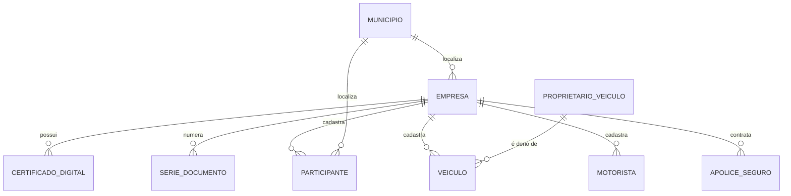

# Emissor CT-e / MDF-e — Levantamento de Requisitos (v1)

> Documento vivo. Toda mudança de escopo ou de leiaute deve ser registrada aqui antes de virar código.
> Última revisão: 19/11/2026.

## 1. Objetivo

Aplicativo desktop (Windows Forms, .NET 10) **multiempresa** para emissão de CT-e (modelo 57) e MDF-e (modelo 58), modal rodoviário, em conformidade com o leiaute vigente da SEFAZ. Numa segunda fase, o núcleo (domínio, dados e DF-e) será reaproveitado em uma versão web.

### 1.1 Escopo da versão 1

| Dentro | Fora (fases futuras) |
|---|---|
| CT-e normal, de complemento e de substituição (`tpCTe` 0, 1, 3) | CT-e OS (modelo 67) e GTV-e |
| Tipos de serviço normal, subcontratação e redespacho (`tpServ` 0, 1, 2, 3) | Modais aéreo, aquaviário, ferroviário, dutoviário e multimodal |
| Importação de NF-e/CT-e por XML e por chave de acesso | Geração automática de CIOT via API de IPEF |
| Busca de documentos pela Distribuição DF-e | Averbação automática (depende da definição da averbadora) |
| Eventos do CT-e: cancelamento, CC-e, EPEC, comprovante/insucesso de entrega | Cálculo de rota e vale-pedágio |
| MDF-e: emissão, encerramento, cancelamento, inclusão de condutor, inclusão de DF-e, consulta de não encerrados | Versão web |
| CIOT **informado manualmente** no MDF-e (obrigatório, ver §6.1) | |
| Contingência: SVC (CT-e), EPEC (CT-e) e offline (MDF-e) | |
| DACTE e DAMDFE em PDF | |
| Armazenamento dos XML autorizados por no mínimo 5 anos | |

## 2. Base normativa

| Documento | Pacote / versão | Situação |
|---|---|---|
| CT-e — leiaute 4.00 com Reforma Tributária e Simples Nacional | `PL_CTe_400_NT2026.005 RTC SN_1.00` (contém todos os XSD do NT 2026.004 + eventos SN) | Produção desde 16/11/2026 |
| CT-e — pacote base | `PL_CTe_400` | Histórico, substituído pelo NT 2026.005 |
| MDF-e — leiaute 3.00b | `PL_MDFe_300b_NT012025_1.05` (o zip chama-se `_1_04`) | Vigente |
| MDF-e — NT 2026.001 (CIOT obrigatório, rejeição 684) | Regra de validação, sem novo XSD | Homologação 21/09/2026, produção 23/11/2026 |
| Distribuição DF-e do CT-e | `PL_CTeDistDFe_100` | Vigente |
| Classificação tributária IBS/CBS | IT 2025.002 v1.71 | Tabelas de referência |

Os XSD do NT 2026.005 são a fonte única para geração das classes e para validação do CT-e antes da transmissão.

> **Pendência de documentação:** `MOC_CTe_VisaoGeral_v4_00.pdf` e `MOC_CTe_Anexo_I_Leiaute_e_Regras_de_Validação_v4_00.pdf` no projeto estão salvos como texto puro com extensão .pdf. Substituir pelos PDFs originais do portal, pois as tabelas do Anexo I (regras de validação) perdem o alinhamento.

## 3. Decisões técnicas

| Tema | Decisão | Motivo |
|---|---|---|
| Plataforma | C# .NET 10, Windows Forms, Visual Studio 2026 / VS Code | Definido pelo projeto |
| Banco de dados | SQLite via EF Core na v1; PostgreSQL na fase web | Instalação simples em máquina única; o EF Core permite trocar o provedor sem reescrever o domínio |
| Motor DF-e | Próprio, com classes geradas a partir dos XSD | As NTs de 2026 são recentes; não depender do ritmo de atualização de bibliotecas de terceiros |
| Assinatura | `System.Security.Cryptography.Xml` atrás de `IProvedorCertificado` (implementações A1 e A3) | A3 depende de token e PIN na máquina do usuário e não roda em servidor |
| Comunicação | `HttpClient` com certificado cliente, SOAP 1.2 | Padrão dos webservices CT-e 4.00 e MDF-e 3.00 |
| DACTE / DAMDFE | QuestPDF | Licença Community gratuita abaixo de US$ 1 mi de faturamento anual |
| Multiempresa | Tabela `Empresa` e `EmpresaId` em todos os cadastros e documentos | Cada empresa com certificado, séries e numeração próprios |
| Banco local | `C:\ProgramData\Cte1\emissor.db`, compartilhado pelos usuários Windows da máquina; caminho configurável no `appsettings.json` a partir da fatia P2 | Mesma base para todos os usuários da máquina |
| Migrações | EF Core 10.0.15 com a ferramenta `dotnet-ef` local (`dotnet-tools.json`); migrações em `Emissor.Dados/Migracoes`, aplicadas ao abrir o sistema | Banco atualizado sem script manual |
| Repositório | https://github.com/Ronimarcos/Cte1 | |

### 3.1 Estrutura da solution

```
Cte1.sln
├── src/
│   ├── Emissor.Dominio      → entidades, enums do leiaute, regras de negócio
│   ├── Emissor.Dados        → EF Core (DbContext, migrations, repositórios)
│   ├── Emissor.DFe          → classes dos XSD, montagem, assinatura, validação, webservices
│   └── Emissor.WinForms     → telas; eventos finos chamando serviços
└── tests/
    └── Emissor.Testes       → testes unitários (validação XML, chave de acesso, regras)
```

`Emissor.Dominio`, `Emissor.Dados` e `Emissor.DFe` não podem referenciar Windows Forms, para serem reaproveitados na versão web.

## 4. Dados do emitente (MT, Simples Nacional)

- UF de emissão: **MT** (`cUF` = 51).
- `CRT` = 1 (Simples Nacional). Valores possíveis no leiaute: 1, 2, 3 e 4.
- Grupos de IBS/CBS do Simples Nacional preenchidos conforme NT 2026.005 (campo `tpRegimeIBSCBS` no grupo `emit`).
- Eventos 412140 (Tributação do SN) e 412141 (cancelamento) são **gerados pelo Fisco**: o sistema apenas recebe pela Distribuição DF-e e arquiva vinculados ao CT-e.
- MDF-e autorizado pela SVRS para todas as UFs.
- Autorizador do CT-e de MT e SVC correspondente: confirmar na tabela de webservices do portal antes de implementar a comunicação (não fixar URL de memória).
- Certificados: A1 e A3.

## 5. Modelo de dados dos cadastros

Convenção: toda entidade de cadastro tem `Id`, `EmpresaId` (exceto `Empresa` e tabelas globais), `Ativo`, `CriadoEm` e `AlteradoEm`. A coluna "Tag XML" indica onde o dado é usado no leiaute.

Documentos são gravados **sem máscara**: CPF, CEP, RNTRC e telefone só com dígitos; CNPJ em maiúsculas com letras e dígitos, porque o leiaute já adota o **CNPJ alfanumérico** (`TCnpj`: `[A-Z0-9]{12}[0-9]{2}`); placa sem hífen (`TPlaca`). O dígito verificador de CNPJ/CPF ainda não é conferido. Participante não tem CNPJ/CPF único por empresa, porque o mesmo documento pode ter mais de uma IE (ex.: produtor rural).

### 5.1 Empresa (emitente)

| Campo | Tipo | Obrig. | Tag XML | Observação |
|---|---|---|---|---|
| RazaoSocial | texto(60) | Sim | `emit/xNome` | |
| NomeFantasia | texto(60) | Não | `emit/xFant` | |
| Cnpj | texto(14) | Sim* | `emit/CNPJ` | *ou CPF |
| Cpf | texto(11) | Sim* | `emit/CPF` | |
| Ie | texto(14) | Não | `emit/IE` | |
| IeSt | texto(14) | Não | `emit/IEST` | |
| Crt | enum (1–4) | Sim | `emit/CRT` | |
| RegimeIbsCbs | enum | Não | `emit/tpRegimeIBSCBS` | Valores conforme NT 2026.005 |
| Rntrc | texto(8) | Sim (rodo) | `rodo/RNTRC` (CT-e) e `infANTT/RNTRC` (MDF-e) | |
| Logradouro, Numero, Complemento, Bairro | texto | Sim/Não | `enderEmit/*` | |
| MunicipioId | FK Municipio | Sim | `enderEmit/cMun`, `xMun`, `UF` | |
| Cep | texto(8) | Não | `enderEmit/CEP` | |
| Fone | texto(14) | Não | `enderEmit/fone` | |
| Email | texto(60) | Não | | Envio de XML/DACTE |
| AmbientePadrao | enum (1 Produção, 2 Homologação) | Sim | `ide/tpAmb` | |

### 5.2 CertificadoDigital

| Campo | Tipo | Obrig. | Observação |
|---|---|---|---|
| EmpresaId | FK | Sim | |
| Tipo | enum (A1, A3) | Sim | |
| ArquivoPfx | blob criptografado | Sim (A1) | Nunca gravar em texto puro |
| Senha | texto criptografado | Sim (A1) | |
| Thumbprint | texto(40) | Sim (A3) | Localiza o certificado no repositório do Windows |
| Titular / CnpjTitular | texto | Sim | Lidos do certificado |
| ValidoDe / ValidoAte | data | Sim | Alertar vencimento com antecedência |

### 5.3 SerieDocumento (numeração)

| Campo | Tipo | Obrig. | Tag XML | Observação |
|---|---|---|---|---|
| EmpresaId | FK | Sim | | |
| Modelo | enum (57, 58) | Sim | `ide/mod` | |
| Serie | int (0–999) | Sim | `ide/serie` | |
| Ambiente | enum | Sim | `ide/tpAmb` | Numeração separada por ambiente |
| ProximoNumero | int | Sim | `ide/nCT` / `ide/nMDF` | Incremento transacional |

Chave única: (`EmpresaId`, `Modelo`, `Serie`, `Ambiente`).

### 5.4 Participante (remetente, destinatário, expedidor, recebedor, tomador)

| Campo | Tipo | Obrig. | Tag XML |
|---|---|---|---|
| Cnpj / Cpf | texto | Sim | `*/CNPJ`, `*/CPF` |
| Ie | texto(14) | Não | `*/IE` |
| IndicadorIe | enum (1 contribuinte, 2 isento, 9 não contribuinte) | Sim | `ide/indIEToma` (quando tomador) |
| RazaoSocial | texto(60) | Sim | `*/xNome` |
| NomeFantasia | texto(60) | Não | `*/xFant` |
| Endereço completo + MunicipioId | | Sim | `*/ender*` |
| Fone | texto(14) | Não | `*/fone` |
| Email | texto(60) | Não | `*/email` |

O papel (remetente, destinatário etc.) é definido no documento, não no cadastro: o mesmo participante pode ter papéis diferentes em cada CT-e.

### 5.5 Veiculo

| Campo | Tipo | Obrig. | Tag XML (MDF-e) | Observação |
|---|---|---|---|---|
| Tipo | enum (Tração, Reboque) | Sim | `veicTracao` / `veicReboque` | Até 3 reboques por MDF-e |
| CodigoInterno | texto(10) | Não | `cInt` | |
| Placa | texto(7) | Sim | `placa` | |
| Renavam | texto(11) | Não | `RENAVAM` | |
| TaraKg | int | Sim | `tara` | |
| CapacidadeKg | int | Sim (reboque) | `capKG` | |
| CapacidadeM3 | int | Não | `capM3` | |
| TipoRodado | enum 01–06 | Sim (tração) | `tpRod` | 01 Truck, 02 Toco, 03 Cavalo mecânico, 04 Van, 05 Utilitário, 06 Outros |
| TipoCarroceria | enum 00–05 | Sim | `tpCar` | 00 Não aplicável, 01 Aberta, 02 Fechada/baú, 03 Graneleira, 04 Porta-contêiner, 05 Sider |
| Uf | texto(2) | Não | `UF` | |
| Proprio | bool | Sim | | Se falso, exige `ProprietarioId` |
| ProprietarioId | FK | Condicional | `prop` | |

### 5.6 ProprietarioVeiculo (veículo de terceiro)

| Campo | Tipo | Obrig. | Tag XML |
|---|---|---|---|
| Cnpj / Cpf | texto | Sim | `prop/CNPJ`, `prop/CPF` |
| Rntrc | texto(8) | Sim | `prop/RNTRC` |
| Nome | texto(60) | Sim | `prop/xNome` |
| TipoProprietario | enum (0 TAC agregado, 1 TAC independente, 2 Outros) | Sim | `prop/tpProp` |

### 5.7 Motorista

| Campo | Tipo | Obrig. | Tag XML |
|---|---|---|---|
| Nome | texto(60) | Sim | `condutor/xNome` |
| Cpf | texto(11) | Sim | `condutor/CPF` |
| Telefone | texto | Não | — (uso interno) |

Até 10 condutores por MDF-e.

### 5.8 ApoliceSeguro

| Campo | Tipo | Obrig. | Tag XML (MDF-e `seg`) |
|---|---|---|---|
| ResponsavelSeguro | enum (1 Emitente, 2 Contratante) | Sim | `infResp/respSeg` |
| CnpjCpfResponsavel | texto | Condicional | `infResp/CNPJ`, `infResp/CPF` |
| NomeSeguradora | texto(30) | Sim | `infSeg/xSeg` |
| CnpjSeguradora | texto(14) | Sim | `infSeg/CNPJ` |
| NumeroApolice | texto(20) | Sim | `nApol` |

O número de averbação (`nAver`) é por viagem/documento, não por apólice; fica no MDF-e.

### 5.9 Tabelas globais (sem `EmpresaId`)

- **Municipio**: código IBGE, nome, UF. Carga inicial a partir da lista oficial do IBGE (5.571 municípios, CSV embutido em `Emissor.Dados/Recursos`), feita na primeira abertura, sem internet.
- **CFOP**: código e descrição dos CFOP de transporte.
- **ResponsavelTecnico**: CNPJ, contato, e-mail, fone, idCSRT e CSRT (grupo `infRespTec`). Confirmar com a SEFAZ-MT se o CSRT é exigido.

### 5.10 Diagrama



## 6. Regras de negócio relevantes

### 6.1 CIOT no MDF-e (NT MDF-e 2026.001)

Rejeição **684 – "CIOT deverá ser informado"** quando modal rodoviário e:

- `tpEmit` = 1 (prestador de serviço de transporte), ou
- `tpEmit` = 3 (transportador que emitirá CT-e globalizado), ou
- `tpEmit` = 2 (carga própria) com `tpTransp` informado.

Na v1 o grupo `infANTT/infCIOT` (CIOT + CPF/CNPJ do responsável) é digitado pelo usuário, com o número gerado no portal da IPEF, e o sistema valida a obrigatoriedade **antes** de transmitir.

### 6.2 Demais regras

- O CT-e deve ser autorizado antes do início da prestação; o MDF-e antes do início da viagem.
- MDF-e não encerrado bloqueia novo MDF-e para o mesmo veículo/UF de carregamento: consultar não encerrados antes de emitir.
- Numeração reservada dentro de transação; número sem autorização deve ser inutilizado (CT-e).
- XML autorizado (`procCTe`, `procMDFe`, `procEvento*`) guardado por no mínimo 5 anos, com cópia de segurança.
- A busca "no site da SEFAZ" é feita exclusivamente pelo webservice de Distribuição DF-e; o portal de consulta usa CAPTCHA e não será automatizado. A distribuição só entrega o XML completo de documentos em que o CNPJ da empresa é interessado. **Validar com casos reais da empresa.**

## 7. Pendências

| # | Item | Responsável |
|---|---|---|
| 1 | Definir seguradora/averbadora para a averbação automática | Roni |
| 2 | Definir IPEF para geração automática de CIOT (fase futura) | Roni |
| 3 | Substituir os dois PDFs do MOC CT-e salvos como texto | Roni |
| 4 | Confirmar autorizador e SVC do CT-e para MT na tabela de webservices | Desenvolvimento |
| 5 | Confirmar exigência de CSRT pela SEFAZ-MT | Desenvolvimento |
| 6 | Definir se o grupo `infPag` (pagamento do frete) do MDF-e entra na v1 | Roni |
| 7 | Obter XML reais de NF-e e CT-e para testar importação e subcontratação | Roni |
| 8 | ~~Enviar imagens de referência das telas de cadastro~~ — encerrada em 23/11/2026: seguido o padrão proposto (§8.1) | Roni |

## 8. Próximos passos

1. Criar a solution e os projetos vazios (§3.1) e fazer o primeiro commit.
2. Prototipar as telas: principal (seleção de empresa), cadastros (§5), emissão de CT-e e emissão de MDF-e.
3. Validar as telas antes de implementar persistência e integração com a SEFAZ.

### 8.1 Decisões do protótipo (19/11/2026)

| Tema | Decisão |
|---|---|
| Tela principal | Mantém o formato já validado (MDI com menus e barra de status do ambiente). Não adotar a barra lateral do sistema de referência. |
| Próxima fatia | Telas de cadastro (§5), com dados fictícios em memória. |
| Padrão das telas de cadastro | Sem imagens de referência (23/11/2026), adotado o padrão proposto: janela MDI com lista (pesquisa, grade, Novo/Editar/Excluir/Fechar; duplo clique, Enter e Delete) e edição em diálogo modal com Salvar/Cancelar. Campos obrigatórios marcados com `*`. |
| Fatia 1 dos cadastros (23/11/2026) | Empresa, Participante, Veículo e Proprietário de veículo, com dados fictícios em memória. Certificados, Séries, Motoristas e Apólices ficam para a fatia 2. |
| Fatia 2 dos cadastros (23/11/2026) | Certificados digitais, Séries de documentos, Motoristas e Apólices de seguro, no mesmo padrão. Certificado: no protótipo o .pfx e a senha não são lidos nem guardados; titular, CNPJ e validade são digitados e a lista destaca vencidos e os que vencem em até 30 dias. Série: próximo número editável só na inclusão (continuação de outro emissor); depois avança só com a emissão. Motorista: só nome, CPF e telefone (sem CNH por enquanto). |
| Emissão de CT-e (23/11/2026) | Assistente em 5 etapas (identificação, participantes, carga e documentos, valores e impostos, conferência), com validação por etapa, mais a consulta de CT-e com filtro por período, situação e texto. Participantes podem ser incluídos e editados sem sair da emissão. "Concluir" grava como **Pronto para transmitir**, sem simular autorização (sem chave, protocolo ou DACTE fictícios). Importar XML e buscar por chave aparecem, mas só avisam que dependem do motor DF-e. ICMS do Simples (`ICMSSN`, CST 90, `indSN` 1) só informativo; IBS/CBS a calcular na implementação. `tpServ` 4 (multimodal) fora da v1. MDF-e fica para a fatia seguinte, no mesmo formato. |
| Emissão de MDF-e (23/11/2026) | Assistente em 5 etapas (identificação e percurso, carregamento e descarga, veículos/condutores/CIOT, carga/seguro/totais, conferência) e consulta de MDF-e, no mesmo formato do CT-e e em classes próprias (o assistente do CT-e não foi alterado). CT-e "Pronto para transmitir" podem ser vinculados a um município de descarga; valor e peso são somados a partir deles. CIOT validado conforme §6.1 (rejeição 684); seguro exigido para tipos de emitente 1 e 3. Contratante e pagamento do frete (`infContratante`, `infPag`) fora do protótipo até a pendência 6. Eventos (encerrar, cancelar, incluir condutor, incluir DF-e) aparecem na consulta só com aviso. A consulta de MDF-e não encerrado (§6.2) não é simulada: depende da SEFAZ. |
| Teclas de atalho (23/11/2026) | Menus: Ctrl+T/Ctrl+Shift+T (emitir/consultar CT-e), Ctrl+M/Ctrl+Shift+D (MDF-e; Ctrl+Shift+M é capturado pelo Microsoft Teams), Ctrl+Shift+P/V/O (participantes, veículos, motoristas), Ctrl+Shift+E (trocar empresa), Alt+F4 (sair). Listas: Insert/F2 novo, Enter editar, Delete excluir, Ctrl+F/F3 pesquisa, Esc fecha. Edição: Enter/Ctrl+S salva, Esc cancela. Assistente de CT-e: Ctrl+→/← avança/volta, Ctrl+S rascunho, Ctrl+Enter conclui, Esc cancela. F1 mostra a lista em qualquer tela. Seleção de empresa: Enter confirma a linha destacada. |
| Controle de usuários / login | Fora da v1; entra em versão futura. |
| Certificado digital, municípios (IBGE) e validações de CNPJ/CPF | Ficam para depois da validação visual das telas. |

Referência de usabilidade vista (fluxo de emissão de outro emissor web), usada só como inspiração, sem copiar marca ou identidade visual:

- Listas em grade com pesquisa, filtro, seleção por linha, situação em etiqueta colorida e menu de ações por linha; botões "Novo" e "Em lote" no topo.
- Emissão de CT-e em assistente: documento que o usuário tem (NF-e, CT-e de outra transportadora, nota de produtor, outro) → tipo de serviço (subcontratação, redespacho, redespacho intermediário) → origem do documento (XML, chave de acesso, digitação) → documentos da carga com totais (produto predominante, valor, peso com unidade) → conferência (remetente, destinatário, tomador, expedidor/recebedor, CFOP sugerido, componentes do frete, tributação, informações adicionais) → salvar e emitir, com aviso de espera da SEFAZ e de autorização.
- Participantes escolhidos em lista com botões de editar e incluir, permitindo cadastrar sem sair da emissão.

### 8.2 Persistência (23/11/2026)

| Fatia | Conteúdo | Situação |
|---|---|---|
| P1 | Entidades dos cadastros e regras de validação em `Emissor.Dominio`; `EmissorDbContext`, configurações, `RepositorioCadastro<T>` e migração `Inicial` em `Emissor.Dados`; testes com SQLite em memória | Concluída (telas ainda usam dados fictícios) |
| P2a | Banco preparado na abertura (migrações, `appsettings.json` com `Banco:Caminho`, vazio = padrão), injeção de dependência (`IDbContextFactory`, um contexto por operação), carga dos 5.571 municípios do IBGE (CSV embutido, baixado em 25/11/2026 da API `servicodados.ibge.gov.br`), dados de demonstração oferecidos com o banco sem empresas, cadastro e seleção de empresa no banco (CNPJ ou CPF; município com digitação e sugestões). A lista genérica de cadastros passou a ser assíncrona. Ponte provisória `EmpresaPrototipo.DeEntidade` para os assistentes | Concluída |
| P2b | Participantes, veículos, proprietários, motoristas, apólices e séries no banco (base `FonteCadastroBanco` e `ServicoCadastro<T>`; diálogos gravam e continuam abertos se o banco recusar; exclusões barradas pelo banco). Dados de demonstração completos, com os mesmos códigos dos dados em memória; quem só tinha as empresas da P2a recebe a oferta de completar. Certificados continuam em memória até a P3 (exigem arquivo e senha criptografados). Os assistentes de CT-e/MDF-e ainda leem os dados em memória até a P2c | Concluída |
| P2c | Assistentes e consultas de CT-e/MDF-e leem os cadastros do banco (`CadastrosEmissao`, lido ao abrir cada tela); incluir/editar participante dentro do CT-e grava no banco; municípios do percurso com os 5.571 do IBGE. Removidas a ponte `EmpresaPrototipo` e as 8 classes de cadastro em memória. Continuam em memória: documentos CT-e/MDF-e de exemplo (até a P4, apontando para os códigos da demonstração; sem eles aparece "(não encontrado)") e certificados (até a P3) | Concluída |
| P3 | Certificado real: A1 criptografado e A3 pelo repositório do Windows, atrás de `IProvedorCertificado` | Pendente |
| P4 | CT-e e MDF-e gravados no banco, junto com o motor DF-e | Pendente |
