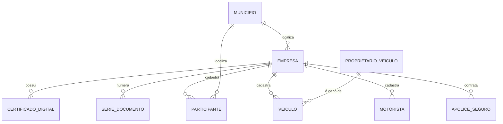

# Emissor CT-e / MDF-e — Levantamento de Requisitos (v1)

> Documento vivo. Toda mudança de escopo ou de leiaute deve ser registrada aqui antes de virar código.
> Última revisão: 19/11/2026.

## 1. Objetivo

Aplicativo desktop (Windows Forms, .NET 10) **multiempresa** para emissão de CT-e (modelo 57) e MDF-e (modelo 58), modal rodoviário, em conformidade com o leiaute vigente da SEFAZ. Numa segunda fase, o núcleo (domínio, dados e DF-e) será reaproveitado em uma versão web.

### 1.1 Escopo da versão 1

| Dentro | Fora (fases futuras) |
|---|---|
| CT-e normal, de complemento e de substituição (`tpCTe` 0, 1, 3) | CT-e OS (modelo 67) e GTV-e |
| Tipos de serviço normal, subcontratação e redespacho (`tpServ` 0, 1, 2, 3) | Modais aéreo, aquaviário, ferroviário, dutoviário e multimodal |
| Importação de NF-e/CT-e por XML e por chave de acesso | Geração automática de CIOT via API de IPEF |
| Busca de documentos pela Distribuição DF-e | Averbação automática (depende da definição da averbadora) |
| Eventos do CT-e: cancelamento, CC-e, EPEC, comprovante/insucesso de entrega | Cálculo de rota e vale-pedágio |
| MDF-e: emissão, encerramento, cancelamento, inclusão de condutor, inclusão de DF-e, consulta de não encerrados | Versão web |
| CIOT **informado manualmente** no MDF-e (obrigatório, ver §6.1) | |
| Contingência: SVC (CT-e), EPEC (CT-e) e offline (MDF-e) | |
| DACTE e DAMDFE em PDF | |
| Armazenamento dos XML autorizados por no mínimo 5 anos | |

## 2. Base normativa

| Documento | Pacote / versão | Situação |
|---|---|---|
| CT-e — leiaute 4.00 com Reforma Tributária e Simples Nacional | `PL_CTe_400_NT2026.005 RTC SN_1.00` (contém todos os XSD do NT 2026.004 + eventos SN) | Produção desde 16/11/2026 |
| CT-e — pacote base | `PL_CTe_400` | Histórico, substituído pelo NT 2026.005 |
| MDF-e — leiaute 3.00b | `PL_MDFe_300b_NT012025_1.05` (o zip chama-se `_1_04`) | Vigente |
| MDF-e — NT 2026.001 (CIOT obrigatório, rejeição 684) | Regra de validação, sem novo XSD | Homologação 21/09/2026, produção 23/11/2026 |
| Distribuição DF-e do CT-e | `PL_CTeDistDFe_100` | Vigente |
| Classificação tributária IBS/CBS | IT 2025.002 v1.71 (outubro/2026; PDF em `docs/moc/`) e tabela online oficial da SVRS | Tabelas de referência |

Os XSD do NT 2026.005 são a fonte única para geração das classes e para validação do CT-e antes da transmissão.

> **Pendência de documentação:** `MOC_CTe_VisaoGeral_v4_00.pdf` e `MOC_CTe_Anexo_I_Leiaute_e_Regras_de_Validação_v4_00.pdf` no projeto estão salvos como texto puro com extensão .pdf. Substituir pelos PDFs originais do portal, pois as tabelas do Anexo I (regras de validação) perdem o alinhamento.

## 3. Decisões técnicas

| Tema | Decisão | Motivo |
|---|---|---|
| Plataforma | C# .NET 10, Windows Forms, Visual Studio 2026 / VS Code | Definido pelo projeto |
| Banco de dados | SQLite via EF Core na v1; PostgreSQL na fase web | Instalação simples em máquina única; o EF Core permite trocar o provedor sem reescrever o domínio |
| Motor DF-e | Próprio, com classes geradas a partir dos XSD | As NTs de 2026 são recentes; não depender do ritmo de atualização de bibliotecas de terceiros |
| Assinatura | `System.Security.Cryptography.Xml` atrás de `IProvedorCertificado` (implementações A1 e A3) | A3 depende de token e PIN na máquina do usuário e não roda em servidor |
| Comunicação | `HttpClient` com certificado cliente, SOAP 1.2 | Padrão dos webservices CT-e 4.00 e MDF-e 3.00 |
| DACTE / DAMDFE | QuestPDF | Licença Community gratuita abaixo de US$ 1 mi de faturamento anual |
| Multiempresa | Tabela `Empresa` e `EmpresaId` em todos os cadastros e documentos | Cada empresa com certificado, séries e numeração próprios |
| Banco local | `%LOCALAPPDATA%\Cte1\emissor.db`, na pasta do usuário do Windows (até a fatia A3 era `C:\ProgramData\Cte1\emissor.db`, compartilhado pela máquina); caminho configurável no `appsettings.json` | Uma base por usuário do Windows (§8.5, A3) |
| Migrações | EF Core 10.0.15 com a ferramenta `dotnet-ef` local (`dotnet-tools.json`); migrações em `Emissor.Dados/Migracoes`, aplicadas ao abrir o sistema | Banco atualizado sem script manual |
| Repositório | https://github.com/Ronimarcos/Cte1 | |

### 3.1 Estrutura da solution

```
Cte1.sln
├── src/
│   ├── Emissor.Dominio      → entidades, enums do leiaute, regras de negócio
│   ├── Emissor.Dados        → EF Core (DbContext, migrations, repositórios)
│   ├── Emissor.DFe          → classes dos XSD, montagem, assinatura, validação, webservices
│   └── Emissor.WinForms     → telas; eventos finos chamando serviços
└── tests/
    └── Emissor.Testes       → testes unitários (validação XML, chave de acesso, regras)
```

`Emissor.Dominio`, `Emissor.Dados` e `Emissor.DFe` não podem referenciar Windows Forms, para serem reaproveitados na versão web.

## 4. Dados do emitente (MT, Simples Nacional)

- UF de emissão: **MT** (`cUF` = 51).
- `CRT` = 1 (Simples Nacional). Valores possíveis no leiaute: 1, 2, 3 e 4.
- Grupos de IBS/CBS do Simples Nacional preenchidos conforme NT 2026.005 (campo `tpRegimeIBSCBS` no grupo `emit`).
- Eventos 412140 (Tributação do SN) e 412141 (cancelamento) são **gerados pelo Fisco**: o sistema apenas recebe pela Distribuição DF-e e arquiva vinculados ao CT-e.
- MDF-e autorizado pela SVRS para todas as UFs.
- Autorizador do CT-e de MT e SVC correspondente: confirmar na tabela de webservices do portal antes de implementar a comunicação (não fixar URL de memória).
- Certificados: A1 e A3.

## 5. Modelo de dados dos cadastros

Convenção: toda entidade de cadastro tem `Id`, `EmpresaId` (exceto `Empresa` e tabelas globais), `Ativo`, `CriadoEm` e `AlteradoEm`. A coluna "Tag XML" indica onde o dado é usado no leiaute.

Documentos são gravados **sem máscara**: CPF, CEP, RNTRC e telefone só com dígitos; CNPJ em maiúsculas com letras e dígitos, porque o leiaute já adota o **CNPJ alfanumérico** (`TCnpj`: `[A-Z0-9]{12}[0-9]{2}`); placa sem hífen (`TPlaca`). O dígito verificador de CNPJ/CPF ainda não é conferido. Participante não tem CNPJ/CPF único por empresa, porque o mesmo documento pode ter mais de uma IE (ex.: produtor rural).

### 5.1 Empresa (emitente)

| Campo | Tipo | Obrig. | Tag XML | Observação |
|---|---|---|---|---|
| RazaoSocial | texto(60) | Sim | `emit/xNome` | |
| NomeFantasia | texto(60) | Não | `emit/xFant` | |
| Cnpj | texto(14) | Sim* | `emit/CNPJ` | *ou CPF |
| Cpf | texto(11) | Sim* | `emit/CPF` | |
| Ie | texto(14) | Não | `emit/IE` | |
| IeSt | texto(14) | Não | `emit/IEST` | |
| Crt | enum (1–4) | Sim | `emit/CRT` | |
| RegimeIbsCbs | enum | Não | `emit/tpRegimeIBSCBS` | Valores conforme NT 2026.005 |
| Rntrc | texto(8) | Sim (rodo) | `rodo/RNTRC` (CT-e) e `infANTT/RNTRC` (MDF-e) | |
| Logradouro, Numero, Complemento, Bairro | texto | Sim/Não | `enderEmit/*` | |
| MunicipioId | FK Municipio | Sim | `enderEmit/cMun`, `xMun`, `UF` | |
| Cep | texto(8) | Não | `enderEmit/CEP` | |
| Fone | texto(14) | Não | `enderEmit/fone` | |
| Email | texto(60) | Não | | Envio de XML/DACTE |
| AmbientePadrao | enum (1 Produção, 2 Homologação) | Sim | `ide/tpAmb` | |

### 5.2 CertificadoDigital

| Campo | Tipo | Obrig. | Observação |
|---|---|---|---|
| EmpresaId | FK | Sim | |
| Tipo | enum (A1, A3) | Sim | |
| ArquivoPfx | blob criptografado | Sim (A1) | Nunca gravar em texto puro |
| Senha | texto criptografado | Sim (A1) | |
| Thumbprint | texto(40) | Sim (A3) | Localiza o certificado no repositório do Windows |
| Titular / CnpjTitular | texto | Sim | Lidos do certificado |
| ValidoDe / ValidoAte | data | Sim | Alertar vencimento com antecedência |

Regras (P3): arquivo e senha do A1 criptografados com DPAPI no escopo da máquina (`ProtetorDpapi`; desde a A3, escopo do usuário do Windows, §8.5); o certificado precisa ter a mesma raiz de CNPJ (8 primeiros caracteres) da empresa, ou o mesmo CPF; certificado vencido não é gravado. Titular e documento vêm do SAN ICP-Brasil (OID 2.16.76.1.3.3 CNPJ / 2.16.76.1.3.1 CPF) ou, na falta dele, do CN "NOME:CNPJ".

### 5.3 SerieDocumento (numeração)

| Campo | Tipo | Obrig. | Tag XML | Observação |
|---|---|---|---|---|
| EmpresaId | FK | Sim | | |
| Modelo | enum (57, 58) | Sim | `ide/mod` | |
| Serie | int (0–999) | Sim | `ide/serie` | |
| Ambiente | enum | Sim | `ide/tpAmb` | Numeração separada por ambiente |
| ProximoNumero | int | Sim | `ide/nCT` / `ide/nMDF` | Incremento transacional |

Chave única: (`EmpresaId`, `Modelo`, `Serie`, `Ambiente`).

### 5.4 Participante (remetente, destinatário, expedidor, recebedor, tomador)

| Campo | Tipo | Obrig. | Tag XML |
|---|---|---|---|
| Cnpj / Cpf | texto | Sim | `*/CNPJ`, `*/CPF` |
| Ie | texto(14) | Não | `*/IE` |
| IndicadorIe | enum (1 contribuinte, 2 isento, 9 não contribuinte) | Sim | `ide/indIEToma` (quando tomador) |
| RazaoSocial | texto(60) | Sim | `*/xNome` |
| NomeFantasia | texto(60) | Não | `*/xFant` |
| Endereço completo + MunicipioId | | Sim | `*/ender*` |
| Fone | texto(14) | Não | `*/fone` |
| Email | texto(60) | Não | `*/email` |

O papel (remetente, destinatário etc.) é definido no documento, não no cadastro: o mesmo participante pode ter papéis diferentes em cada CT-e.

### 5.5 Veiculo

| Campo | Tipo | Obrig. | Tag XML (MDF-e) | Observação |
|---|---|---|---|---|
| Tipo | enum (Tração, Reboque) | Sim | `veicTracao` / `veicReboque` | Até 3 reboques por MDF-e |
| CodigoInterno | texto(10) | Não | `cInt` | |
| Placa | texto(7) | Sim | `placa` | |
| Renavam | texto(11) | Não | `RENAVAM` | |
| TaraKg | int | Sim | `tara` | |
| CapacidadeKg | int | Sim (reboque) | `capKG` | |
| CapacidadeM3 | int | Não | `capM3` | |
| TipoRodado | enum 01–06 | Sim (tração) | `tpRod` | 01 Truck, 02 Toco, 03 Cavalo mecânico, 04 Van, 05 Utilitário, 06 Outros |
| TipoCarroceria | enum 00–05 | Sim | `tpCar` | 00 Não aplicável, 01 Aberta, 02 Fechada/baú, 03 Graneleira, 04 Porta-contêiner, 05 Sider |
| Uf | texto(2) | Não | `UF` | |
| Proprio | bool | Sim | | Se falso, exige `ProprietarioId` |
| ProprietarioId | FK | Condicional | `prop` | |

### 5.6 ProprietarioVeiculo (veículo de terceiro)

| Campo | Tipo | Obrig. | Tag XML |
|---|---|---|---|
| Cnpj / Cpf | texto | Sim | `prop/CNPJ`, `prop/CPF` |
| Rntrc | texto(8) | Sim | `prop/RNTRC` |
| Nome | texto(60) | Sim | `prop/xNome` |
| TipoProprietario | enum (0 TAC agregado, 1 TAC independente, 2 Outros) | Sim | `prop/tpProp` |
| Ie | texto(14): dígitos ou "ISENTO" (tipo `TIeDest`) | Não | `prop/IE` |
| Uf | texto(2) | Sim | `prop/UF` (incluídos na P4b2; quem já tinha proprietários completa a UF ao editar) |

### 5.7 Motorista

| Campo | Tipo | Obrig. | Tag XML |
|---|---|---|---|
| Nome | texto(60) | Sim | `condutor/xNome` |
| Cpf | texto(11) | Sim | `condutor/CPF` |
| Telefone | texto | Não | — (uso interno) |

Até 10 condutores por MDF-e.

### 5.8 ApoliceSeguro

| Campo | Tipo | Obrig. | Tag XML (MDF-e `seg`) |
|---|---|---|---|
| ResponsavelSeguro | enum (1 Emitente, 2 Contratante) | Sim | `infResp/respSeg` |
| CnpjCpfResponsavel | texto | Condicional | `infResp/CNPJ`, `infResp/CPF` |
| NomeSeguradora | texto(30) | Sim | `infSeg/xSeg` |
| CnpjSeguradora | texto(14) | Sim | `infSeg/CNPJ` |
| NumeroApolice | texto(20) | Sim | `nApol` |

O número de averbação (`nAver`) é por viagem/documento, não por apólice; fica no MDF-e.

### 5.9 Tabelas globais (sem `EmpresaId`)

- **Municipio**: código IBGE, nome, UF. Carga inicial a partir da lista oficial do IBGE (5.571 municípios, CSV embutido em `Emissor.Dados/Recursos`), feita na primeira abertura, sem internet.
- **CFOP**: código e descrição dos CFOP de transporte.
- **ResponsavelTecnico**: CNPJ, contato, e-mail, fone, idCSRT e CSRT (grupo `infRespTec`). Confirmar com a SEFAZ-MT se o CSRT é exigido.

### 5.10 Diagrama



## 6. Regras de negócio relevantes

### 6.1 CIOT no MDF-e (NT MDF-e 2026.001)

Rejeição **684 – "CIOT deverá ser informado"** quando modal rodoviário e:

- `tpEmit` = 1 (prestador de serviço de transporte), ou
- `tpEmit` = 3 (transportador que emitirá CT-e globalizado), ou
- `tpEmit` = 2 (carga própria) com `tpTransp` informado.

Na v1 o grupo `infANTT/infCIOT` (CIOT + CPF/CNPJ do responsável) é digitado pelo usuário, com o número gerado no portal da IPEF, e o sistema valida a obrigatoriedade **antes** de transmitir.

### 6.2 Demais regras

- O CT-e deve ser autorizado antes do início da prestação; o MDF-e antes do início da viagem.
- MDF-e não encerrado bloqueia novo MDF-e para o mesmo veículo/UF de carregamento: consultar não encerrados antes de emitir.
- Numeração reservada dentro de transação. Não há inutilização: o MOC CT-e 4.00 (versão 4.00a) eliminou o serviço de inutilização junto com a autorização assíncrona, e o pacote de schemas não traz mais o `inutCTe`; com a autorização síncrona, o número rejeitado pode ser reaproveitado.
- XML autorizado (`procCTe`, `procMDFe`, `procEvento*`) guardado por no mínimo 5 anos, com cópia de segurança.
- A busca "no site da SEFAZ" é feita exclusivamente pelo webservice de Distribuição DF-e; o portal de consulta usa CAPTCHA e não será automatizado. A distribuição só entrega o XML completo de documentos em que o CNPJ da empresa é interessado. **Validar com casos reais da empresa.**

## 7. Pendências

| # | Item | Responsável |
|---|---|---|
| 1 | Definir seguradora/averbadora para a averbação automática | Roni |
| 2 | Definir IPEF para geração automática de CIOT (fase futura) | Roni |
| 3 | ~~Substituir os dois PDFs do MOC CT-e salvos como texto~~ — encerrada em 25/11/2026: PDFs originais em `docs/moc/` (fora do Git): MOC CT-e 4.00 Visão Geral e Anexo I, MOC MDF-e 3.00b Visão Geral e Anexo I | Roni |
| 4 | ~~Confirmar autorizador e SVC do CT-e para MT na tabela de webservices~~ — encerrada em 25/11/2026 (§8.3): MT tem autorizador próprio; contingência na SVC-RS | Desenvolvimento |
| 10 | ~~Confiança na cadeia ICP-Brasil dos servidores da SEFAZ~~ — encerrada em 25/11/2026: o app leva as 7 raízes vigentes do repositório AC-Raiz do ITI (v4, v5, v6, v7, v10, v12, v13; `src/Emissor.DFe/Webservices/Raizes`) e valida o TLS da SEFAZ por elas, sem mexer no Windows. Teste real: TLS aceito pela SVRS (HTTP 403 sem certificado de cliente, como esperado) | Roni / TI |
| 11 | (Parcial em 25/11/2026: MOC lido, ver §8.3; falta confirmar o namespace dos serviços V4 do CT-e e o elemento de retorno no WSDL ou numa chamada real.) Obter o MOC do CT-e 4.00 e do MDF-e 3.00b (PDF original) ou os WSDL de homologação, para o formato SOAP dos webservices (namespaces, ação e elemento da mensagem); não escrever de memória. Os WSDL exigem certificado de cliente ICP-Brasil válido (a SVRS respondeu 403 sem ele): com o certificado de homologação da empresa cadastrado, o emissor consegue lê-los | Roni |
| 12 | ~~Homologação do CT-e da SEFAZ-MT indisponível (do lado da SEFAZ)~~ — encerrada em 26/11/2026: o painel "Consultar Disponibilidade" (verificação de 26/11/2026 08:14:01) mostrou MT em verde em Recepção Sinc, Status do Serviço, Recepção GTVE, Recepção Evento e Consulta Cadastro (só a Recepção CT-e OS seguia em vermelho, fora do escopo) e a porta 443 de `homologacao.sefaz.mt.gov.br` voltou a aceitar conexão. Falta só o certificado da empresa para o teste real (P4c1) e a P4c2. Histórico: em 25/11/2026 `homologacao.sefaz.mt.gov.br` (IP 201.49.172.12) respondeu ao ping, mas recusou conexão na porta 443 na rede da empresa, no 4G e na Starlink; a produção (`cte.sefaz.mt.gov.br`, 201.49.172.13) e a SVRS responderam. O painel oficial "Consultar Disponibilidade" do portal nacional em homologação (`hom.cte.fazenda.gov.br/portal/disponibilidade.aspx?versao=4.00&tipoConteudo=XbSeqxE8pl8=`, verificação de 25/11/2026 16:07:31) mostrou MT em vermelho em todos os serviços e os demais autorizadores em verde. Não é rede nem emissor: acompanhar o painel e, se seguir vermelho por alguns dias, abrir chamado no suporte do CT-e da SEFAZ-MT. Não usar a SVC-RS como alternativa: ela só atende MT quando a própria SEFAZ-MT ativa a contingência. Bloqueia o teste real do CT-e (P4c1) e a P4c2; o MDF-e (SVRS) não depende disso | SEFAZ-MT (acompanhar: Roni) |
| 5 | Confirmar exigência de CSRT pela SEFAZ-MT | Desenvolvimento |
| 6 | Definir se o grupo `infPag` (pagamento do frete) do MDF-e entra na v1 | Roni |
| 7 | Obter XML reais de NF-e e CT-e para testar importação e subcontratação | Roni |
| 8 | ~~Enviar imagens de referência das telas de cadastro~~ — encerrada em 23/11/2026: seguido o padrão proposto (§8.1) | Roni |
| 9 | IBS/CBS do CT-e no Simples Nacional (regras da NT 2026.005, ver §8.4). Definir com a contabilidade: (a) se a empresa optou pelo regime regular do IBS/CBS (campo `RegimeIbsCbs` da empresa, que já existe); (b) o CST e o `cClassTrib` do serviço de transporte (proposta: CST 000 / `cClassTrib` 000001, ver §8.4); (c) de onde vêm as alíquotas efetivas do Simples para IBS e CBS (`pIBSSN`, `pCBSSN`) e como mudam mês a mês. **Bloqueia a autorização (P4c2)**: sem o grupo, o CT-e de CRT 1 sem regime regular é rejeitado (1101) | Roni |

## 8. Próximos passos

1. Criar a solution e os projetos vazios (§3.1) e fazer o primeiro commit.
2. Prototipar as telas: principal (seleção de empresa), cadastros (§5), emissão de CT-e e emissão de MDF-e.
3. Validar as telas antes de implementar persistência e integração com a SEFAZ.

### 8.1 Decisões do protótipo (19/11/2026)

| Tema | Decisão |
|---|---|
| Tela principal | Mantém o formato já validado (MDI com menus e barra de status do ambiente). Não adotar a barra lateral do sistema de referência. |
| Próxima fatia | Telas de cadastro (§5), com dados fictícios em memória. |
| Padrão das telas de cadastro | Sem imagens de referência (23/11/2026), adotado o padrão proposto: janela MDI com lista (pesquisa, grade, Novo/Editar/Excluir/Fechar; duplo clique, Enter e Delete) e edição em diálogo modal com Salvar/Cancelar. Campos obrigatórios marcados com `*`. |
| Fatia 1 dos cadastros (23/11/2026) | Empresa, Participante, Veículo e Proprietário de veículo, com dados fictícios em memória. Certificados, Séries, Motoristas e Apólices ficam para a fatia 2. |
| Fatia 2 dos cadastros (23/11/2026) | Certificados digitais, Séries de documentos, Motoristas e Apólices de seguro, no mesmo padrão. Certificado: no protótipo o .pfx e a senha não são lidos nem guardados; titular, CNPJ e validade são digitados e a lista destaca vencidos e os que vencem em até 30 dias. Série: próximo número editável só na inclusão (continuação de outro emissor); depois avança só com a emissão. Motorista: só nome, CPF e telefone (sem CNH por enquanto). |
| Emissão de CT-e (23/11/2026) | Assistente em 5 etapas (identificação, participantes, carga e documentos, valores e impostos, conferência), com validação por etapa, mais a consulta de CT-e com filtro por período, situação e texto. Participantes podem ser incluídos e editados sem sair da emissão. "Concluir" grava como **Pronto para transmitir**, sem simular autorização (sem chave, protocolo ou DACTE fictícios). Importar XML e buscar por chave aparecem, mas só avisam que dependem do motor DF-e. ICMS do Simples (`ICMSSN`, CST 90, `indSN` 1) só informativo; IBS/CBS a calcular na implementação. `tpServ` 4 (multimodal) fora da v1. MDF-e fica para a fatia seguinte, no mesmo formato. |
| Emissão de MDF-e (23/11/2026) | Assistente em 5 etapas (identificação e percurso, carregamento e descarga, veículos/condutores/CIOT, carga/seguro/totais, conferência) e consulta de MDF-e, no mesmo formato do CT-e e em classes próprias (o assistente do CT-e não foi alterado). CT-e "Pronto para transmitir" podem ser vinculados a um município de descarga; valor e peso são somados a partir deles. CIOT validado conforme §6.1 (rejeição 684); seguro exigido para tipos de emitente 1 e 3. Contratante e pagamento do frete (`infContratante`, `infPag`) fora do protótipo até a pendência 6. Eventos (encerrar, cancelar, incluir condutor, incluir DF-e) aparecem na consulta só com aviso. A consulta de MDF-e não encerrado (§6.2) não é simulada: depende da SEFAZ. |
| Teclas de atalho (23/11/2026) | Menus: Ctrl+T/Ctrl+Shift+T (emitir/consultar CT-e), Ctrl+M/Ctrl+Shift+D (MDF-e; Ctrl+Shift+M é capturado pelo Microsoft Teams), Ctrl+Shift+P/V/O (participantes, veículos, motoristas), Ctrl+Shift+E (trocar empresa), Alt+F4 (sair). Listas: Insert/F2 novo, Enter editar, Delete excluir, Ctrl+F/F3 pesquisa, Esc fecha. Edição: Enter/Ctrl+S salva, Esc cancela. Assistente de CT-e: Ctrl+→/← avança/volta, Ctrl+S rascunho, Ctrl+Enter conclui, Esc cancela. F1 mostra a lista em qualquer tela. Seleção de empresa: Enter confirma a linha destacada. |
| Controle de usuários / login | Fora da v1; entra em versão futura. |
| Certificado digital, municípios (IBGE) e validações de CNPJ/CPF | Ficam para depois da validação visual das telas. |

Referência de usabilidade vista (fluxo de emissão de outro emissor web), usada só como inspiração, sem copiar marca ou identidade visual:

- Listas em grade com pesquisa, filtro, seleção por linha, situação em etiqueta colorida e menu de ações por linha; botões "Novo" e "Em lote" no topo.
- Emissão de CT-e em assistente: documento que o usuário tem (NF-e, CT-e de outra transportadora, nota de produtor, outro) → tipo de serviço (subcontratação, redespacho, redespacho intermediário) → origem do documento (XML, chave de acesso, digitação) → documentos da carga com totais (produto predominante, valor, peso com unidade) → conferência (remetente, destinatário, tomador, expedidor/recebedor, CFOP sugerido, componentes do frete, tributação, informações adicionais) → salvar e emitir, com aviso de espera da SEFAZ e de autorização.
- Participantes escolhidos em lista com botões de editar e incluir, permitindo cadastrar sem sair da emissão.

### 8.2 Persistência (23/11/2026)

| Fatia | Conteúdo | Situação |
|---|---|---|
| P1 | Entidades dos cadastros e regras de validação em `Emissor.Dominio`; `EmissorDbContext`, configurações, `RepositorioCadastro<T>` e migração `Inicial` em `Emissor.Dados`; testes com SQLite em memória | Concluída (telas ainda usam dados fictícios) |
| P2a | Banco preparado na abertura (migrações, `appsettings.json` com `Banco:Caminho`, vazio = padrão), injeção de dependência (`IDbContextFactory`, um contexto por operação), carga dos 5.571 municípios do IBGE (CSV embutido, baixado em 25/11/2026 da API `servicodados.ibge.gov.br`), dados de demonstração oferecidos com o banco sem empresas, cadastro e seleção de empresa no banco (CNPJ ou CPF; município com digitação e sugestões). A lista genérica de cadastros passou a ser assíncrona. Ponte provisória `EmpresaPrototipo.DeEntidade` para os assistentes | Concluída |
| P2b | Participantes, veículos, proprietários, motoristas, apólices e séries no banco (base `FonteCadastroBanco` e `ServicoCadastro<T>`; diálogos gravam e continuam abertos se o banco recusar; exclusões barradas pelo banco). Dados de demonstração completos, com os mesmos códigos dos dados em memória; quem só tinha as empresas da P2a recebe a oferta de completar. Certificados continuam em memória até a P3 (exigem arquivo e senha criptografados). Os assistentes de CT-e/MDF-e ainda leem os dados em memória até a P2c | Concluída |
| P2c | Assistentes e consultas de CT-e/MDF-e leem os cadastros do banco (`CadastrosEmissao`, lido ao abrir cada tela); incluir/editar participante dentro do CT-e grava no banco; municípios do percurso com os 5.571 do IBGE. Removidas a ponte `EmpresaPrototipo` e as 8 classes de cadastro em memória. Continuam em memória: documentos CT-e/MDF-e de exemplo (até a P4, apontando para os códigos da demonstração; sem eles aparece "(não encontrado)") e certificados (até a P3) | Concluída |
| P3 | Certificado real: A1 lido do `.pfx` com a senha e guardado criptografado (DPAPI, escopo da máquina); A3 escolhido na lista do repositório pessoal do Windows e localizado pelo thumbprint; titular, CNPJ e validade lidos do certificado; bloqueio de outra raiz de CNPJ e de certificado vencido; `IProvedorCertificado` (A1 e A3) pronto para a assinatura da P4. Removidas as classes `CertificadoPrototipo` e `FonteCadastro` | Concluída |
| P4a | CT-e e MDF-e gravados no banco (`ConhecimentoTransporte` e `ManifestoEletronico` no Dominio, com as regras por etapa e a obrigatoriedade do CIOT; base `DocumentoFiscal`). Situações "Em digitação" (grava incompleto) e "Pronto para transmitir" (grava só sem pendências). Itens em tabelas filhas (quantidades, NF-e, documentos anteriores, componentes, descargas com documentos, CIOT); percurso, municípios de carregamento, reboques, condutores e averbações em JSON na própria tabela (reboques e condutores sem chave estrangeira: a existência é conferida na montagem do XML, P4b). Série, participantes, municípios, veículo de tração, apólice e CT-e vinculado no MDF-e como chaves estrangeiras: cadastro ou CT-e usado em documento não pode ser excluído. Só rascunho pode ser excluído. Número **não** é reservado nesta fatia: sai da série, em transação, só na transmissão (P4c). Migração `DocumentosCteMdfe`; dados de demonstração com 3 CT-e e 2 MDF-e de exemplo (oferecidos também a quem já tinha os cadastros). Removidas as 8 classes de documento do protótipo | Concluída |
| P4b1 | Motor DF-e offline do CT-e: classes geradas dos XSD do CT-e 4.00 (NT 2026.005) com `dotnet-xscgen` (`ferramentas/gerar-classes-dfe.ps1`, código gerado em `src/Emissor.DFe/Leiaute/Cte`, não editar à mão); chave de acesso com dígito verificador módulo 11 (CNPJ alfanumérico: valor ASCII − 48); montagem (`MontadorCte`) com os padrões tpImp 1, tpEmis 1, procEmi 0, retira 1, modal 01, cMunEnv do município da empresa, indIEToma do cadastro do tomador, RNTRC da empresa e ICMS do Simples Nacional (ICMSSN, CST 90, indSN 1; só CRT 1 nesta versão); assinatura XMLDSig enveloped com os algoritmos fixados no XSD (C14N, RSA-SHA1, SHA1) pela `IProvedorCertificado`; validação contra `cte_v4.00.xsd` e, à parte, contra `cteModalRodoviario_v4.00.xsd` (o `infModal` aceita qualquer conteúdo). Botão "Gerar XML de teste" na consulta de CT-e: sempre `tpAmb` 2, próximo número da série **sem reserva**, nada enviado à SEFAZ, XML salvo só onde o usuário escolher. Ficam fora: grupo IBS/CBS (pendência 9) e QR Code `infCTeSupl` (P4c), ambos opcionais no XSD | Concluída |
| P4b2 | Motor DF-e offline do MDF-e 3.00b: classes geradas (`src/Emissor.DFe/Leiaute/Mdfe`, assinatura em namespace próprio), `MontadorMdfe` (identificação, emitente, descargas com CT-e/NF-e, seguro, produto predominante, totais, modal rodoviário com RNTRC, CIOT, tração, condutores, reboques e proprietário de veículo de terceiro), assinatura do `infMDFe` e validação contra `mdfe_v3.00.xsd` e `mdfeModalRodoviario_v3.00.xsd`. Partes comuns extraídas (`FormatacaoLeiaute`, `XmlGerado`). Proprietário ganhou IE e UF (migração `ProprietarioIeUf`). Botão "Gerar XML de teste" na consulta de MDF-e, com as mesmas regras do CT-e. CT-e emitido no sistema ainda não tem chave: vincular no MDF-e só depois da autorização (P4c); até lá é pendência. Ficam fora: QR Code (P4c), carga lotação `infLotacao` (regra a conferir na P4c), contratante e pagamento do frete (pendência 6) | Concluída |
| P4c0 | Conferência das tabelas oficiais de webservices (homologação), registrada no §8.3 | Concluída |
| P4c1 | Comunicação com a SEFAZ e status do serviço: raízes ICP-Brasil embutidas e validação TLS própria (`ConfiancaIcpBrasil`); cliente HTTPS com o certificado da empresa (`ClienteHttpSefaz`, TLS 1.2/1.3, verificação nunca desligada); endereços só de homologação, produção recusada (`TabelaWebservices`, em código no lugar do JSON previsto); envelope SOAP 1.2 do MOC sem Header, com XML ou GZip+Base64 (`ClienteSoap`), SOAP Fault e HTTP 403 traduzidos; status do CT-e e do MDF-e com as classes do XSD, mensagem validada antes do envio (`ServicoStatus`); menu Sistema → Status da SEFAZ (homologação). Testado sem rede (servidor HTTP falso) e no app: com o certificado de teste a SVRS responde 403 e a homologação de MT recusa a conexão (pendência 12). Falta a chamada real com o certificado ICP-Brasil da empresa, que também confirma o namespace do CT-e (pendência 11) | Concluída (falta teste real) |
| P4c2 | Autorização do CT-e em homologação: número reservado da série, QR Code, retorno, `procCTe` guardado | Pendente |
| P4c3 | Autorização do MDF-e em homologação, aceitando CT-e autorizados do sistema | Pendente |
| P4d1 | Eventos offline: cancelamento (110111) e carta de correção (110110) do CT-e 4.00; cancelamento (110111), encerramento (110112) e inclusão de condutor (110114) do MDF-e 3.00b. Classes geradas dos XSD dos eventos em namespaces próprios (`Leiaute/CteEvento` e `Leiaute/MdfeEvento`, porque os XSD dos eventos redeclaram tipos do documento); montagem com o Id "ID" + tipo + chave + sequência (3 dígitos no CT-e; 2 no MDF-e até 99), assinatura do `infEvento` e validação do envelope e do detalhe (que o envelope aceita sem validar) contra os XSD (`GeradorXmlEvento`). Regras do MOC no domínio (`RegrasEvento`): justificativa de 15 a 255 caracteres, CC-e com sequência até 20, item de 1 a 99 e os campos proibidos do item 13.1, encerramento com data não futura e município, condutor com nome e CPF; para a transmissão, documento autorizado, prazo de cancelamento (CT-e 168 horas, MDF-e 24 horas) e CT-e com CC-e registrada não cancelável. Tabela `Eventos` (com `EventoCorrecoes`), sequência única por documento e tipo, alçada no `RepositorioEventos`, sem exclusão; documentos ganham chave, protocolo e data da autorização (migração `Eventos`). Telas: na consulta de CT-e, "Cancelar CT-e" e "Carta de correção"; na de MDF-e, os botões Encerrar, Cancelar MDF-e e Incluir condutor do protótipo. Por enquanto geram só o XML de teste (assinado e validado, registrado na auditoria), sem gravar o evento; enquanto o documento não for autorizado, chave e protocolo são de teste | Concluída |
| P4d2 | Transmissão dos eventos em homologação (`CTeRecepcaoEventoV4` e `MDFeRecepcaoEvento`), retorno (`retEvento`), `procEvento`, gravação do evento e mudança de situação do documento (cancelado, encerrado); histórico de eventos na consulta. Depende da P4c2 e da P4c3 (documento autorizado). Fora da P4d: inclusão de DF-e no MDF-e (110115), consulta de MDF-e não encerrados e comprovante/insucesso de entrega do CT-e. DACTE e DAMDFE (QuestPDF) numa fatia P5 | Pendente |

### 8.3 Webservices de homologação (conferidos em 25/11/2026)

Fonte: tabela "Relação de Serviços Web" do portal nacional do CT-e em homologação (`hom.cte.fazenda.gov.br/portal/webServices.aspx`) e página "Serviços" do portal do MDF-e (`dfe-portal.svrs.rs.gov.br/Mdfe/Servicos`). Produção fica fora do emissor até haver confirmação explícita.

**CT-e — autorizador MT (próprio).** Contingência: SVC-RS (o portal lista MT entre os estados da SVC-RS).

| Serviço | Versão | URL (homologação) |
|---|---|---|
| CTeStatusServicoV4 | 4.00 | `https://homologacao.sefaz.mt.gov.br/ctews2/services/CTeStatusServicoV4` |
| CTeConsultaV4 | 4.00 | `https://homologacao.sefaz.mt.gov.br/ctews2/services/CTeConsultaV4` |
| CTeRecepcaoEventoV4 | 4.00 | `https://homologacao.sefaz.mt.gov.br/ctews2/services/CTeRecepcaoEventoV4` |
| CTeRecepcaoSincV4 | 4.00 | `https://homologacao.sefaz.mt.gov.br/ctews2/services/CTeRecepcaoSincV4` |
| QR Code | 4.00 | `https://homologacao.sefaz.mt.gov.br/cte/qrcode` |

**CT-e — contingência SVC-RS (homologação).** Status `https://cte-homologacao.svrs.rs.gov.br/ws/CTeStatusServicoV4/CTeStatusServicoV4.asmx`, recepção síncrona `.../CTeRecepcaoSincV4/CTeRecepcaoSincV4.asmx`, consulta `.../CTeConsultaV4/CTeConsultaV4.asmx`, eventos `.../CTeRecepcaoEventoV4/CTeRecepcaoEventoV4.asmx`; QR Code `https://dfe-portal.svrs.rs.gov.br/cte/qrCode`.

**CT-e — Distribuição DF-e (Ambiente Nacional, homologação).** `https://hom1.cte.fazenda.gov.br/CTeDistribuicaoDFe/CTeDistribuicaoDFe.asmx`.

**MDF-e — autorizador SVRS (Ambiente Nacional), recepção síncrona.**

| Serviço | Versão | URL (homologação) |
|---|---|---|
| MDFeStatusServico | 3.00 | `https://mdfe-homologacao.svrs.rs.gov.br/ws/MDFeStatusServico/MDFeStatusServico.asmx` |
| MDFeRecepcaoSinc | 3.00 | `https://mdfe-homologacao.svrs.rs.gov.br/ws/MDFeRecepcaoSinc/MDFeRecepcaoSinc.asmx` |
| MDFeConsulta | 3.00 | `https://mdfe-homologacao.svrs.rs.gov.br/ws/MDFeConsulta/MDFeConsulta.asmx` |
| MDFeRecepcaoEvento | 3.00 | `https://mdfe-homologacao.svrs.rs.gov.br/ws/MDFeRecepcaoEvento/MDFeRecepcaoEvento.asmx` |
| MDFeConsNaoEnc | 3.00 | `https://mdfe-homologacao.svrs.rs.gov.br/ws/MDFeConsNaoEnc/MDFeConsNaoEnc.asmx` |
| MDFeDistribuicaoDFe | 1.00 | `https://mdfe-homologacao.svrs.rs.gov.br/ws/MDFeDistribuicaoDFe/MDFeDistribuicaoDFe.asmx` |
| QR Code | — | `https://dfe-portal.svrs.rs.gov.br/mdfe/qrCode` |


**Formato das mensagens (MOC lido em 25/11/2026, `docs/moc/`).**

- Comunicação: TLS com autenticação mútua (certificado ICP-Brasil A1/A3 com o CNPJ), SOAP 1.2, Document/Literal, WS-I Basic Profile. O SOAP Header foi descontinuado (CT-e: "Eliminação do SOAP Header dos Webservices", 04/2023; MDF-e: "não será mais utilizada e recomenda-se que o emitente não envie"); a mensagem vai só no `soap12:Body`.
- CT-e: a mensagem vai no elemento `cteDadosMsg`. Recepção (CT-e modelo 57) compactada em GZip e convertida para Base64; demais serviços com XML sem compactação. Serviços e métodos do MOC 4.00: `CTeRecepcaoSincV4`/`cteRecepcao` (síncrono, retorno `retCTe`), `CTeStatusServicoV4`/`cteStatusServicoCT` (`consStatServCTe` → `retConsStatServCTe`; `xServ` = STATUS), `CTeConsultaV4`/`cteConsultaCT`, `CTeRecepcaoEventoV4`/`cteRecepcaoEvento`.
- CT-e, ponto a confirmar: o único exemplo de namespace do MOC é `http://www.portalfiscal.inf.br/cte/wsdl/CTeRecepcaoSinc`, sem o "V4" do nome do serviço publicado na tabela oficial (`CTeRecepcaoSincV4`). Confirmar no WSDL ou na primeira chamada real (a SEFAZ responde SOAP Fault se o namespace estiver errado).
- MDF-e: a mensagem vai no elemento `mdfeDadosMsg`, com namespace `http://www.portalfiscal.inf.br/mdfe/wsdl/<serviço>` (exemplos do MOC para `MDFeRecepcaoSinc` e `MDFeRecepcaoEvento`). Recepção compactada em GZip + Base64; consulta, eventos e status sem compactação. Serviços e métodos do MOC 3.00b: `MDFeRecepcaoSinc`/`mdfeRecepcao`, `MDFeConsulta`/`mdfeConsultaMDF`, `MDFeConsNaoEnc`/`mdfeConsNaoEnc`, `MDFeStatusServico`/`mdfeStatusServicoMDF`, `MDFeRecepcaoEvento`/`mdfeRecepcaoEvento`.
- Retorno: o MOC descreve só o XML de retorno (`retConsStatServCTe`, `retCTe`...), não o elemento SOAP que o envolve; o emissor localiza o retorno pelo nome do elemento dentro do `Body`.
- QR Code do CT-e (emissão normal): URL do portal da SEFAZ autorizadora + `?chCTe=<chave>&tpAmb=<1|2>`; em contingência (FS-DA/EPEC) acrescenta `&sign=` com a assinatura RSA-SHA1 em Base64 da chave, feita com o certificado que assina o CT-e. A URL de homologação de MT está na tabela acima.

Observações da conferência: os WSDL não puderam ser lidos (certificado TLS da SEFAZ não reconhecido neste Windows — pendência 10), então o formato SOAP ainda depende do MOC ou dos WSDL (pendência 11). O MDF-e usa recepção síncrona (`MDFeRecepcaoSinc`), além do lote (`enviMDFe`) previsto nos XSD.

### 8.4 IBS/CBS no Simples Nacional (NT 2026.005 do CT-e e NT 2026.004 v1.01, lidas em 25/11/2026)

PDFs em `docs/moc/` (fora do Git). Cronograma da NT 2026.005: regras de validação em produção desde **16/11/2026**; evento de Tributação do SN em homologação 26/10/2026 e produção 14/12/2026. NT 2026.004 v1.01 (valor líquido): produção 14/12/2026.

**Como preencher (tabela do item 2.2 da NT 2026.005), pelo CRT e pelo `tpRegimeIBSCBS` do emitente:**

| Situação | CRT | `tpRegimeIBSCBS` | `gIBSCBS` (gIBSUF, gIBSMun, gCBS) | `gTribSN` |
|---|---|---|---|---|
| Simples Nacional **sem** regime regular (caso provável da emitente inicial) | 1 | não informar | **não informar** (rejeição 1100) | **informar com `gIBSSN` e `gCBSSN`** (rejeição 1101) |
| Simples Nacional **com** regime regular do IBS/CBS | 1 | 1 | informar se o CST exigir | não informar (1102) |
| Excesso de sublimite sem regime regular | 2 | não informar | informar, CBS com alíquota zero | só `gCBSSN` (1103/1104) |
| Excesso de sublimite com regime regular | 2 | 1 | informar | não informar |
| Regime Normal com opção pendente pelo SN (2, 3 ou 4) | 3 | 2, 3 ou 4 | informar | conforme a tabela da NT |
| MEI | 4 | não informar (1092) | não informar (1107) | não informar (1107) |

- `gTribSN` fica dentro de `imp/IBSCBS`, que pelo XSD exige `CST` e `cClassTrib`. `gIBSSN` = `pIBSSN` (alíquota efetiva do IBS no SN, 3v2-4) + `vIBSSN` (13v2); `gCBSSN` = `pCBSSN` + `vCBSSN`.
- Compra governamental da União em 2027–2028: `pIBSSN` e `vIBSSN` zerados (1108/1109).
- CT-e complementar de emitente SN com várias chaves complementadas: todas do mesmo ano e mês (909).
- `vRBSNitem` do evento de Tributação do SN: para CT-e, um único item, com a receita bruta = `vTPrest` quando tributável.
- Alíquotas de 2026 quando o grupo regular é informado: CBS 0,90 %, IBS UF 0,1 %, IBS Mun 0 % (em homologação, em 2026, também se aceitam as de 2027).

**Classificação tributária (CST e `cClassTrib`) permitida no CT-e.** Fonte: IT 2025.002 v1.71 (outubro/2026, em `docs/moc/`; em relação à v1.70 só atualiza textos e ativa a DIR para 410003 e 410999, sem efeito no CT-e) e a tabela online oficial que ela indica (`dfe-portal.svrs.rs.gov.br/DFE/ClassificacaoTributaria`, visão aberta por `cClassTrib`, consultada em 25/11/2026). O `cClassTrib` tem 6 dígitos e os 3 primeiros são o CST. Só estes códigos trazem "CTE" na lista de documentos permitidos:

| CST | `cClassTrib` | Situação | Redução IBS/CBS | `tpRBSN` |
|---|---|---|---|---|
| 000 | 000001 | Situações tributadas integralmente pelo IBS e CBS | 0 % / 0 % | 1 - Receita bruta interna |
| 200 | 200001 | Transporte de bens até zonas de processamento de exportação ou exportados a partir delas | 100 % / 100 % | 3 - Exportação direta |
| 200 | 200020 | Operação de sociedades cooperativas optantes por regime específico | 100 % / 100 % | 1 - Receita bruta interna |
| 200 | 200050 | Transporte aéreo regional coletivo de passageiros ou de carga | 40 % / 40 % | 1 - Receita bruta interna |
| 410 | 410001 | Bonificações no documento, sem evento posterior | sem alíquota | 0 - Não é receita bruta |
| 410 | 410003 | Doações e amostras grátis sem contraprestação | sem alíquota | 0 - Não é receita bruta |
| 410 | 410004 | Exportações de bens e serviços | sem alíquota | 3 - Exportação direta |
| 410 | 410015 | Fornecimento por transportador autônomo não contribuinte | sem alíquota | 9 - Incompatível com SN |
| 410 | 410026 | Doações e amostras grátis com anulação de crédito | sem alíquota | 0 - Não é receita bruta |
| 410 | 410027 | Exportação de serviço ou de bem imaterial | sem alíquota | 3 - Exportação direta |
| 410 | 410035 | Fornecimento realizado por nanoempreendedor | sem alíquota | 9 - Incompatível com SN |
| 410 | 410999 | Operações não onerosas sem previsão de tributação | sem alíquota | 0 - Não é receita bruta |

**Proposta para a contabilidade confirmar (pendência 9, item b):** frete rodoviário de carga no mercado interno, pago pelo tomador, por empresa do Simples Nacional → **CST 000 / `cClassTrib` 000001** (tributação integral, receita bruta interna). Casos especiais da lista (exportação, cooperativa) só se a empresa tiver essas operações. Com CRT 1 sem regime regular, o grupo `gIBSCBS` continua **não** sendo informado (exceção da regra 315 e regra 1100 da NT 2026.005); vai só o `gTribSN`. O `indDoacao` do 000001 é exigido apenas quando a operação for doação tributada, o que não é o caso do frete pago.

**Consequência para o emissor:** o XML de teste da P4b1 sai sem `IBSCBS` (decisão daquela fatia) e, para a emitente de CRT 1 sem regime regular, seria rejeitado com 1101. Antes de autorizar (P4c2) é preciso montar `IBSCBS` com `CST`, `cClassTrib` e `gTribSN`, com os valores da pendência 9.

**Outras mudanças da NT 2026.004 v1.01 a considerar adiante:** o `tpEmis` 5 (FS-DA) e o evento EPEC deixam de ser aceitos e entra a emissão em **contingência offline** (`tpEmis` = 2); novo grupo de multa e juros; regra do valor total do documento (soma de IBS e CBS a partir de 2027).

### 8.5 Controle de acesso e auditoria (decidido em 25/11/2026)

Requisito: o emissor pode emitir para várias empresas; cada login só vê e altera as empresas da sua alçada, e os vários certificados respeitam as empresas e as alçadas.

**Decisões (respostas do responsável):** cada usuário na sua máquina (banco local), evoluindo para versão web em domínio próprio; perfis **Administrador** e **Operador**; login com **usuário e senha do sistema**; **auditoria** de quem fez cada ação.

| Fatia | Conteúdo | Situação |
|---|---|---|
| A1 | Usuários e login: `Usuario` (login, nome, perfil, ativo, troca obrigatória, tentativas, bloqueio, último acesso) e empresas liberadas (`UsuarioEmpresas`); senha só como hash PBKDF2-SHA256 (600.000 iterações, sal de 16 bytes; mínimo 8 caracteres com letras e números); bloqueio de 15 minutos após 5 erros seguidos; mensagem igual para login ou senha errados. Primeiro acesso cria o administrador (vale também para bancos já existentes). **Alçada aplicada na camada de dados** (`IContextoAcesso` nos repositórios): o operador só lista, abre, grava e exclui registros das empresas liberadas (registro de outra empresa se comporta como inexistente); empresas, certificados e usuários só o administrador grava; não é possível ficar sem administrador ativo nem excluir o próprio usuário; empresa liberada para algum usuário não pode ser excluída. Telas: login, primeiro acesso, troca de senha (obrigatória após senha definida pelo administrador), cadastro de usuários (só administrador) e menu Sistema com "Usuários", "Trocar senha" e "Trocar usuário"; o operador não vê os menus de Empresas, Certificados e Usuários; a barra de status mostra o usuário. Migração `UsuariosAcesso` | Concluída |
| A2 | Auditoria: tabela `Auditoria` (data e hora, usuário e login, empresa, ação, entidade, código do registro e detalhe) gravada na mesma transação de toda inclusão, alteração e exclusão feita pelo usuário logado (coleta pelo `ChangeTracker`; a alteração lista só os campos que mudaram, com antes → depois; itens de documento aparecem como "Itens alterados"); a alteração compara com o registro gravado no banco. Eventos: login aceito, recusado, bloqueado e de usuário inativo, primeiro administrador, troca de senha, entrada e troca de empresa, troca de usuário, XML de teste e consulta de status da SEFAZ. Senha e certificado aparecem só como "alterado". Operações internas (preparação do banco, demonstração) não são auditadas. Gatilhos no banco recusam UPDATE e DELETE na tabela. Consulta só para o administrador (Sistema → Auditoria), com filtro por período, usuário, empresa, ação e texto, limitada a 2.000 linhas. Migração `Auditoria` | Concluída |
| A3 | Proteção local: banco padrão em `%LOCALAPPDATA%\Cte1\emissor.db` (pasta do usuário do Windows; o `appsettings.json` continua podendo indicar outro caminho). Na primeira abertura, se o banco novo não existe e existe o antigo em `C:\ProgramData\Cte1\emissor.db`, o app pergunta se copia (cópia de segurança do próprio SQLite, em arquivo temporário renomeado no fim; o original não é alterado) e depois pergunta se exclui o antigo (padrão "Não", com aviso de que outros usuários do Windows ainda o leem). Certificados A1 protegidos pela DPAPI do usuário do Windows (`ProtetorDpapi`, entropia `v2`); na preparação do banco, os gravados com a DPAPI da máquina (`ProtetorDpapiMaquina`, só leitura) são regravados (`RecriptografiaCertificados`, sem auditoria por ser operação interna; rodar de novo não muda nada) e os que não abrem com nenhuma proteção são listados para novo cadastro. **Consequências:** cada usuário do Windows tem o seu banco; se a senha do Windows for redefinida pela TI (e não trocada pelo próprio usuário), a chave da DPAPI pode se perder e os certificados A1 precisam ser cadastrados de novo (o resto do banco não é afetado); a cópia de segurança é o `emissor.db` da pasta de cada usuário | Concluída |

**Limite do desktop:** com banco local, o login protege o uso pela tela; quem copia o arquivo do banco ainda lê os cadastros (não as senhas, que são hash, nem os certificados, depois da A3). O isolamento completo vem com a versão web e o banco no servidor; por isso as regras de acesso ficam no Dominio e no Dados, para a web reaproveitar.
